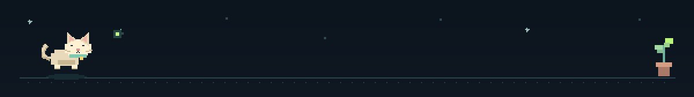
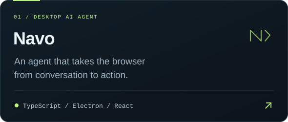
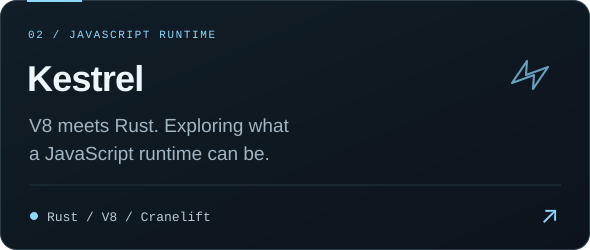
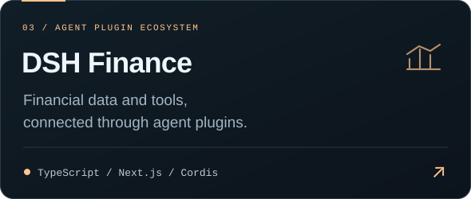
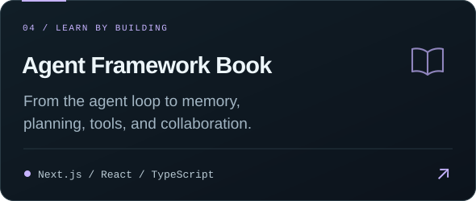

  

  

<b>把好奇心写成代码。</b>

<table>
  <tr>
    <td width="50%"></td>
    <td width="50%"></td>
  </tr>
  <tr>
    <td width="50%"></td>
    <td width="50%"></td>
  </tr>
</table>

<a href="https://github.com/hanjixin?tab=repositories">More experiments ↗</a>

